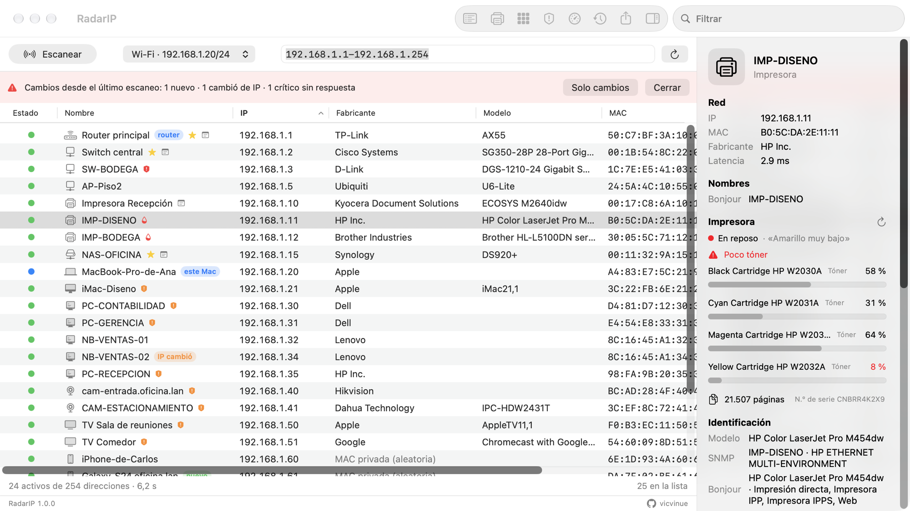
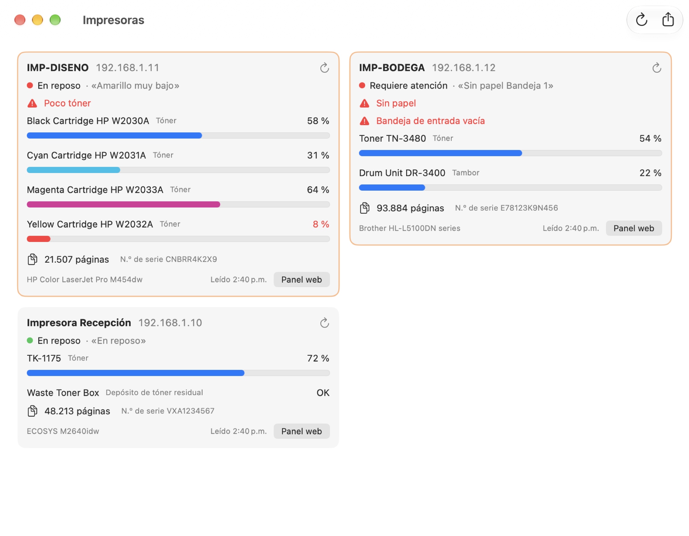
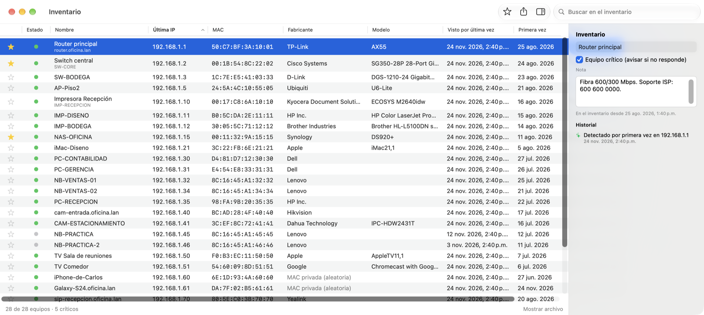
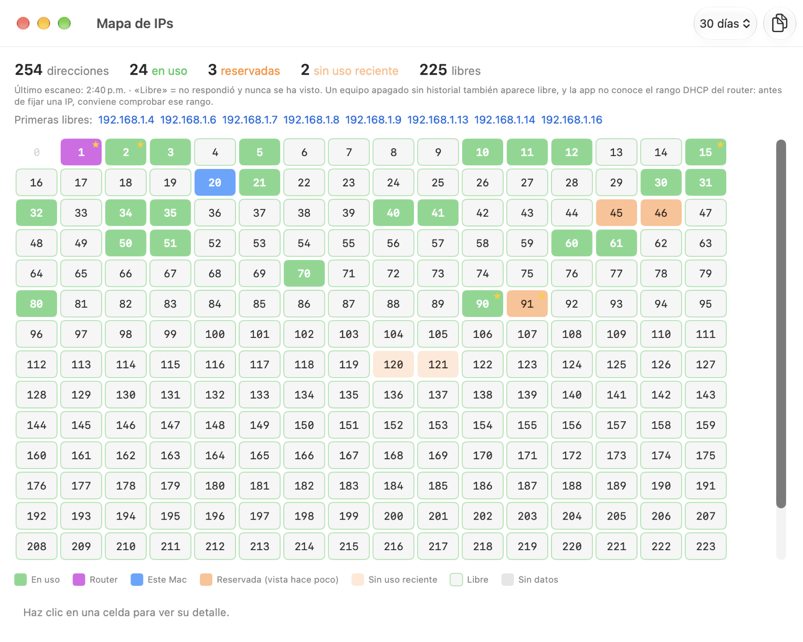
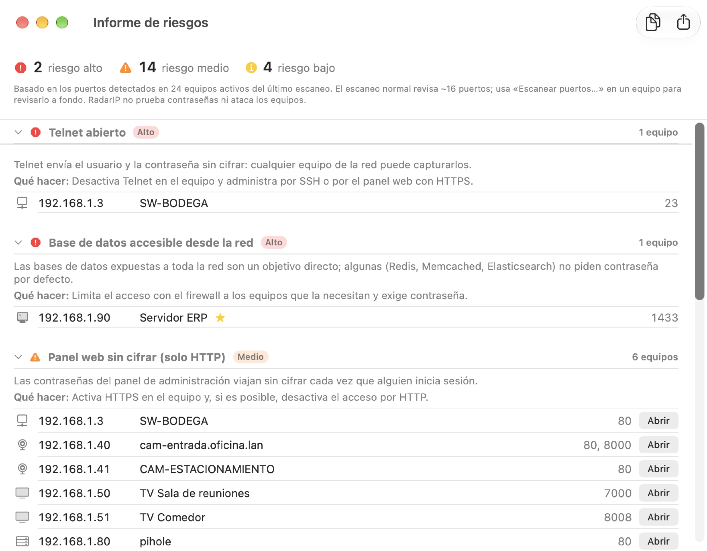
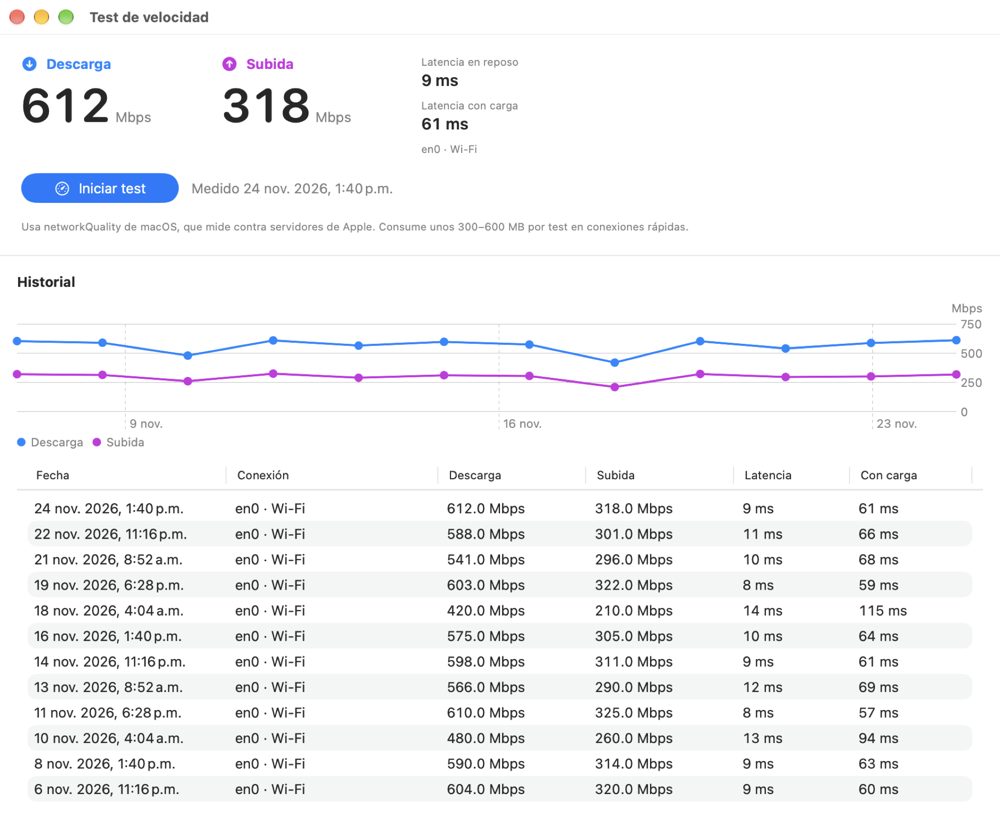

<p align="center">
  
</p>

<h1 align="center">RadarIP</h1>

<p align="center">
  <b>Escáner de red local para macOS.</b><br>
  Descubre qué equipos hay en tu red, qué servicios tienen abiertos, cómo están tus impresoras y qué conviene revisar.
</p>

<p align="center">
  <a href="https://github.com/vicvinue/RadarIP/releases/latest"><b>⬇︎ Descargar RadarIP para Mac</b></a>
  &nbsp;·&nbsp; macOS 14 Sonoma o posterior &nbsp;·&nbsp; Apple Silicon e Intel &nbsp;·&nbsp; Gratis
</p>



> Todas las capturas usan una red de ejemplo; los nombres, direcciones y equipos son ficticios.

---

## ¿Qué puedes hacer con RadarIP?

### Ver todos los equipos de tu red
Pulsa **Escanear** y en pocos segundos aparecen todos los dispositivos conectados: computadores, impresoras, teléfonos, cámaras, televisores, switches, routers… Encuentra incluso los que no responden al ping.

De cada uno muestra:
- **Nombre** del equipo, aunque no lo tengas registrado en ningún lado (lo obtiene de Bonjour, NetBIOS, DNS, SNMP y UPnP).
- **Fabricante** y **modelo** (por ejemplo, *HP Color LaserJet Pro M454dw* o *Cisco SG350-28P*).
- **Dirección IP y MAC**, y el **tiempo de respuesta**.
- **Servicios abiertos**: web, carpetas compartidas, escritorio remoto, SSH, impresión…
- El **tipo de equipo** con un icono, para reconocerlo de un vistazo.

Con un doble clic (o clic derecho) abres directamente lo que ofrece cada equipo: su página web, sus carpetas compartidas, Compartir pantalla, Escritorio remoto o SSH. También puedes **encenderlo a distancia** (Wake-on-LAN), copiar sus datos o exportar la lista a Excel (CSV).

### Revisar las impresoras sin levantarte  <sub>⌘K</sub>
Nivel de **tóner** de cada color, **contador de páginas**, **estado** y **avisos** (sin papel, atasco, puerta abierta, tóner bajo…), el mensaje que muestra su pantalla y el número de serie. Las que necesitan atención aparecen primero. El contador se puede exportar a CSV, útil para el control de impresiones.



> Funciona con las impresoras que tienen **SNMP** activado (la mayoría de las impresoras de oficina lo traen activo de fábrica).

### Llevar un inventario automático  <sub>⌘I</sub>
Cada equipo que aparece queda registrado. Puedes ponerle un **nombre propio**, escribir **notas** (dónde está, quién lo usa, contrato…) y marcarlo como **crítico**. En cada escaneo RadarIP te avisa de:
- **Equipos nuevos** que nunca habían aparecido.
- Equipos que **cambiaron de IP**.
- Equipos críticos que **no responden** (se muestran en rojo aunque estén apagados).



### Encontrar una IP libre  <sub>⌘L</sub>
El **mapa de IPs** muestra en una cuadrícula qué direcciones están en uso, cuáles están ocupadas por equipos apagados que se vieron hace poco y cuáles están libres. Ideal para asignar una IP fija sin pisar a otro equipo.



### Detectar riesgos de seguridad  <sub>⌘J</sub>
Un informe en lenguaje simple con lo que conviene corregir: Telnet o FTP abiertos, paneles de administración sin HTTPS, escritorio remoto expuesto, cámaras, bases de datos accesibles… Para cada punto explica **por qué es un riesgo y qué hacer**. Se puede copiar o exportar.



> RadarIP solo observa: no prueba contraseñas ni ataca ningún equipo.

### Medir la velocidad de internet  <sub>⌘T</sub>
Descarga, subida, latencia en reposo y **latencia con carga** (si sube mucho, tu conexión sufre de *bufferbloat*: videollamadas que se cortan cuando alguien descarga algo). Guarda un historial con gráfico para comparar días y horarios.



### Y además
- **Escaneo de puertos** de un equipo: los más comunes, del 1 al 1024, todos o una lista tuya, con la versión del servicio que responde.
- **Ping con estadísticas** (pérdida, mínimo, promedio, máximo, jitter) y gráfico en vivo, y **traceroute**.
- Funciona con Wi-Fi, cable, adaptadores USB y VPN, y detecta solo la red en la que estás.

---

## Instalación

1. Descarga el archivo **`RadarIP-x.y.z.dmg`** desde la [página de descargas](https://github.com/vicvinue/RadarIP/releases/latest).
2. Ábrelo y arrastra **RadarIP** a la carpeta **Aplicaciones**.
3. Abre RadarIP desde Aplicaciones o Launchpad.

### La primera vez que la abres

RadarIP es gratuita y no está firmada con un certificado de pago de Apple, así que macOS mostrará el aviso *«No se puede verificar el desarrollador»* o *«Apple no pudo verificar que RadarIP esté libre de malware»*. Para abrirla igualmente:

1. Pulsa **Listo** (o **OK**) en el aviso.
2. Ve a **Ajustes del Sistema › Privacidad y seguridad**.
3. Baja hasta el mensaje sobre RadarIP y pulsa **Abrir igualmente**. Confirma con tu contraseña.

Solo hay que hacerlo una vez.

<details>
<summary>Alternativa desde la Terminal</summary>

```sh
xattr -dr com.apple.quarantine /Applications/RadarIP.app
```
</details>

### Permitir el acceso a la red local

Al primer escaneo, macOS pregunta si RadarIP puede **buscar dispositivos en tu red local**. Pulsa **Permitir**: sin este permiso solo verías tu propio Mac.

Si lo rechazaste por error, actívalo en **Ajustes del Sistema › Privacidad y seguridad › Red local** y vuelve a escanear.

---

## Uso rápido

1. Comprueba arriba la red y el rango que se va a revisar (RadarIP los propone solo; también puedes escribir rangos como `192.168.1.1-254`, `10.0.0.0/24` o varias direcciones separadas por coma).
2. Pulsa **Escanear** (⌘R).
3. Selecciona un equipo para ver todos sus detalles en el panel derecho. Haz doble clic para abrirlo o clic derecho para ver todas las acciones.
4. Escribe en **Filtrar** para buscar por nombre, IP, MAC, fabricante, modelo o servicio.

| Atajo | Acción |
|---|---|
| ⌘R | Escanear |
| ⌘. | Detener el escaneo |
| ⌘I | Inventario |
| ⌘K | Impresoras |
| ⌘L | Mapa de IPs |
| ⌘J | Informe de riesgos |
| ⌘T | Test de velocidad |
| ⌘, | Ajustes |

### Ajustes

En **RadarIP › Ajustes** (⌘,) puedes cambiar la **comunidad SNMP**, que es la «clave» de solo lectura con la que se consulta a impresoras y switches. Casi siempre es `public`; si en tu red usan otra, escríbela ahí (puedes poner varias separadas por coma).

---

## Preguntas frecuentes

**Solo aparece mi Mac.**
Falta el permiso de red local: revisa **Ajustes del Sistema › Privacidad y seguridad › Red local** y activa RadarIP.

**Un equipo aparece como «MAC privada (aleatoria)».**
Los iPhone, Android y computadores modernos usan una dirección MAC inventada en cada red Wi-Fi para proteger la privacidad, así que no se puede saber el fabricante. Puedes ponerle un nombre en el inventario.

**Mi impresora no muestra el tóner.**
Necesita tener SNMP activado y usar la misma comunidad que está en Ajustes. Se configura en la página web de la impresora (normalmente en Red › SNMP).

**¿RadarIP envía mis datos a algún lado?**
No. Todo queda en tu Mac (`~/Library/Application Support/RadarIP`). La app solo se comunica con los equipos de tu propia red; la única excepción es el test de velocidad, que mide contra los servidores de Apple con la herramienta `networkQuality` incluida en macOS.

**¿Es legal escanear la red?**
En tu casa o en la red que administras, sí. En redes ajenas (trabajo, universidad, cafetería) pide autorización antes: muchos lugares lo prohíben.

**¿Cómo la desinstalo?**
Arrastra RadarIP desde Aplicaciones a la papelera. Si quieres borrar también el inventario y el historial, elimina la carpeta `~/Library/Application Support/RadarIP`.

---

## Para desarrolladores

RadarIP está escrita en Swift y SwiftUI, sin dependencias externas, y se compila solo con las Command Line Tools de Xcode (`xcode-select --install`):

```sh
./build.sh            # compila build/RadarIP.app para este Mac
./build.sh install    # compila, instala en ~/Applications y abre la app
./build.sh dmg        # versión universal (Apple Silicon + Intel) y build/RadarIP-<versión>.dmg
./build.sh test       # pruebas
./build.sh update-oui # actualiza la base de fabricantes
```

La base de fabricantes (OUI) proviene de [Wireshark](https://www.wireshark.org/) y se descarga en la primera compilación.

## Licencia

[MIT](LICENSE) © [vicvinue](https://github.com/vicvinue)
